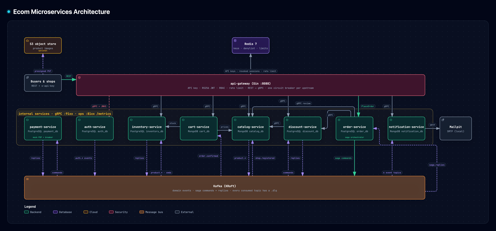

# Ecom — an e-commerce backend built as Go microservices

## What is this?

Ecom is the backend of an online marketplace. **Shops** sign up, create products and manage stock and discount codes;
**buyers** register, browse and search the catalog, fill a cart and check out. Orders are paid, confirmed or cancelled,
and both sides get in-app and email notifications.

It started as a single Express/MongoDB application (`Ecomerce_project`) and was rebuilt as **nine Go services** that each
own their data and talk over gRPC and Kafka. The point of the project is to show, in working and tested code, the patterns
a real distributed system needs: a checkout **saga** with compensation, a **transactional outbox**, **circuit breakers**,
**database per service**, and logs, metrics and traces you can follow across every service.

## Architecture



How to read it:

- **One public entry point.** Clients only ever call `api-gateway` (REST + JSON). The gateway checks the API key, verifies
  the JWT, applies RBAC and rate limits, then calls the right service over **gRPC**, behind one circuit breaker per upstream.
- **Each service owns its data.** No service reads another service's database. PostgreSQL holds relational data
  (auth, inventory, discount, order, payment); MongoDB holds document data (catalog, cart, notification).
- **Kafka connects the services asynchronously.** Domain events (`auth.user.registered`, `catalog.product.created`,
  `order.order.confirmed`, …) let services react to each other, and the checkout saga sends its commands and replies through it.
- **Short synchronous calls use gRPC.** Cart asks catalog for prices and inventory for stock; order and discount ask catalog
  while reviewing a checkout.
- **Images skip the backend.** Catalog signs an S3 upload URL; the client uploads the image straight to the bucket.

### Services

| Service | What it does | Data store | Ports (gRPC / ops HTTP) |
|---|---|---|---|
| **api-gateway** | Public REST API: API key, JWT (RS256) verification, session revocation, RBAC, rate limiting, REST → gRPC, OpenAPI docs | Redis | 8088 (REST) |
| **auth-service** | Shops, users, login sessions with refresh-token rotation, API keys, roles and permissions, signing keys (JWKS) | PostgreSQL `auth_db` | 9101 / 8101 |
| **catalog-service** | Products of several types, SPU / SKU variants, search, publishing, comments, image upload URLs | MongoDB `catalog_db` + Redis cache | 9102 / 8102 |
| **inventory-service** | Stock per product, reservations per order (reserve / release / commit) that expire | PostgreSQL `inventory_db` | 9103 / 8103 |
| **cart-service** | One cart per buyer, with price snapshots | MongoDB `cart_db` | 9104 / 8104 |
| **discount-service** | Discount codes, amount calculation, usage limits and records | PostgreSQL `discount_db` | 9105 / 8105 |
| **order-service** | Checkout review, orders, and the **checkout saga orchestrator** | PostgreSQL `order_db` | 9106 / 8106 |
| **payment-service** | Payments and refunds through a payment-provider adapter (a mock locally) | PostgreSQL `payment_db` | 9107 / 8107 |
| **notification-service** | In-app notifications and email (SMTP; Mailpit locally) | MongoDB `notification_db` | 9108 / 8108 |

Every internal service also serves `/health/live`, `/health/ready` and `/metrics` on its ops port.

### How a checkout works

A checkout touches four services, so it can't run as a single database transaction. order-service runs it as an
**orchestrated saga**. Each step is a Kafka command, and each reply moves the saga to its next state:

1. `POST /orders` (with an `Idempotency-Key` header) stores the order as `PENDING`, the saga state and an outbox
   message in **one** transaction, and returns `202 Accepted` right away.
2. **ReserveStock** → inventory-service holds the items.
3. **ApplyDiscounts** → discount-service records the codes' usage (skipped when the order has none).
4. **ProcessPayment** → payment-service charges the buyer.
5. **CommitStock** → inventory-service turns the reservation into a sale. The order becomes `CONFIRMED`.
6. `order.order.confirmed` is published: cart-service removes the ordered items, and notification-service tells the buyer.

If any step fails or times out, the saga runs the completed steps' **compensations in reverse order** (refund, release
the discount, release the stock) and the order ends `CANCELLED`. The client polls `GET /orders/:id` to see the outcome.
Full detail: [docs/06](docs/06-checkout-saga.md).

## Key design patterns

| Pattern | Why it is here |
|---|---|
| **API gateway** | One place for authentication, authorization, rate limiting and API docs; services stay internal. |
| **Database per service** (polyglot persistence) | Services can change their schema and scale independently; each picks the store that fits its data. |
| **DDD + layered architecture** | `domain` → `usecase` → `transport` / `repository`; business rules have no framework imports. Enforced by `depguard` in `make lint`. |
| **Orchestrated saga** | A checkout spans several services; failures are undone by explicit compensations, not distributed locks. |
| **Transactional outbox / inbox** | A state change and its event are committed together, so events are never lost or invented; consumers drop duplicates. |
| **Retry + dead-letter topics** | A poison message goes to `<topic>.dlq` instead of blocking its partition. |
| **Circuit breaker, timeouts, retries** | A slow or failing service gets a fast `503` instead of taking its callers down with it. |
| **RS256 JWT + refresh rotation + RBAC** | The gateway verifies tokens without a database call; a reused refresh token revokes the whole session. |
| **Cache-aside** | Catalog caches SKUs in Redis, including "not found" results. |
| **Observability** | RED metrics, structured logs and distributed traces: one checkout shows up as a single trace across seven services. |

## Tech stack

| Area | Technology |
|---|---|
| Language | Go 1.26, multi-module Go workspace (`go.work`) |
| Public API | REST + JSON with [Gin](https://github.com/gin-gonic/gin), OpenAPI |
| Service-to-service | gRPC + Protocol Buffers, generated with [buf](https://buf.build) |
| Messaging | Apache Kafka 3.9 (KRaft mode) with [franz-go](https://github.com/twmb/franz-go) |
| Databases | PostgreSQL 17 via [bun](https://bun.uptrace.dev), MongoDB 8.2 (replica set, for transactions) |
| Cache / rate limits | Redis 7 with go-redis |
| Object storage | S3-compatible (presigned uploads; Zenko CloudServer locally) |
| Resilience | [sony/gobreaker](https://github.com/sony/gobreaker), deadlines and retries with jitter |
| Observability | OpenTelemetry, Prometheus, Alertmanager, Grafana, Loki, Tempo, Grafana Alloy |
| Email | SMTP; [Mailpit](https://mailpit.axllent.org) catches mail locally |
| Migrations | Laravel-style migrations and seeders run by each service's `console` binary |
| Testing | Go `testing`, [testcontainers](https://testcontainers.com) (real PostgreSQL, MongoDB, Kafka, Redis), black-box e2e suite |
| Tooling | Docker Compose, golangci-lint, GitHub Actions |

## Repository layout

```
.
├── api-gateway/            public REST API (Gin)
├── auth-service/           ┐
├── catalog-service/        │
├── inventory-service/      │
├── cart-service/           │ one Go module per service
├── discount-service/       │
├── order-service/          │
├── payment-service/        │
├── notification-service/   ┘
├── platform-go/            shared library: Kafka, outbox/inbox, saga, gRPC, breakers, JWT, RBAC, logging, metrics, tracing…
├── proto/                  .proto contracts and generated gRPC code
├── shared-infra/           Docker Compose for the data stores, Kafka and the observability stack
├── e2e/                    end-to-end tests against the running stack
├── docs/                   design documents (see below)
├── scripts/  tools/        start / stop / status / coverage scripts, service scaffolding
└── Makefile
```

Each service has the same shape:

```
<service>/
├── cmd/<service>/      the server (gRPC + Kafka consumers + ops HTTP)
├── cmd/console/        migrate, rollback, seed
├── internal/
│   ├── domain/         aggregates, value objects, domain events — pure Go
│   ├── usecase/        one file per command or query
│   ├── repository/     PostgreSQL (bun) or MongoDB adapters
│   ├── client/         gRPC clients to other services
│   ├── transport/      gRPC handlers and Kafka consumers
│   ├── database/       migrations and seeders
│   └── app/            wires everything together
└── infra/local/        Docker Compose + .env for this service
```

## Getting started

**Requirements:** Go ≥ 1.26, Docker with Compose, [`buf`](https://buf.build/docs/installation), `golangci-lint`, `openssl`, `python3`.

```bash
make start      # generates RS256 keys, starts the infrastructure (+ observability), the nine services, runs migrations and seeds
make status     # health table with every URL
```

The first start takes a few minutes. Then:

| What | URL |
|---|---|
| REST API | http://localhost:8088/v1/api |
| API docs (OpenAPI) | http://localhost:8088/docs |
| Grafana (admin / admin) | http://localhost:3001 (six dashboards in the *Ecom* folder) |
| Prometheus · Alertmanager | http://localhost:9090 · http://localhost:9093 |
| Kafka UI | http://localhost:8080 |
| Mailpit (local inbox) | http://localhost:8025 |

Every request needs the seeded API key `x-api-key: dev-api-key-change-me`. For example, to sign up a shop:

```bash
KEY=dev-api-key-change-me; API=http://localhost:8088/v1/api
curl -s -H "x-api-key: $KEY" -H 'content-type: application/json' \
  -d '{"name":"Acme","email":"shop@example.com","password":"correct-horse"}' \
  $API/shop/signup        # -> access + refresh tokens for the shop
```

A full checkout from there:
1. As the shop, create and publish a product.
2. As a buyer, `POST /user/new_user` and open the verification link in Mailpit.
3. Add the product to `/cart` and call `POST /checkout/review`.
4. Call `POST /orders` with an `Idempotency-Key` header.
5. Poll `GET /orders/:id` until the order is `CONFIRMED` or `CANCELLED`.

[`e2e/order_e2e_test.go`](e2e/order_e2e_test.go) is that walk-through as code.

`make stop` stops everything; `make stop VOLUMES=1` also wipes the data. `make help` lists every target.

## Testing

| Command | What it runs |
|---|---|
| `make lint` | golangci-lint on every module, including the DDD layering rules |
| `make test` | unit tests with `-race`, no Docker needed |
| `make test-integration` | integration tests against real PostgreSQL, MongoDB, Kafka and Redis (testcontainers) |
| `make cover` | unit + integration coverage per module; **fails under 80 %** |
| `make test-e2e` | black-box scenarios against the running stack (`make start` first) |
| `make check-infra` | validates the Compose files, Prometheus / Alertmanager config, alert rules and dashboards |

The e2e suite includes the hard cases:
- A service is killed in the middle of a checkout, and nothing may be lost or duplicated.
- An open circuit breaker answers `503` fast, then recovers.
- One checkout can be found as a single trace across seven services in Tempo.

CI ([`.github/workflows/ci.yml`](.github/workflows/ci.yml)) runs lint, tests and coverage on every push, then the e2e
suite against the full stack.

## Documentation

New here? Start with [02 Architecture](docs/02-architecture.md), then [06 Checkout saga](docs/06-checkout-saga.md).

| Doc | What it answers |
|---|---|
| [01 Requirements](docs/01-requirements.md) | What is ported, what is new, non-functional goals |
| [02 Architecture](docs/02-architecture.md) | Services, boundaries, context map, communication, patterns |
| [03 Project structure](docs/03-project-structure.md) | Repo layout, DDD layering rules, `platform-go`, migrations |
| [04 Data model](docs/04-data-model.md) | Tables / collections per service |
| [05 API design](docs/05-api-design.md) | REST routes, error envelope, gRPC services |
| [06 Checkout saga](docs/06-checkout-saga.md) | Order state machine, steps, compensation, timeouts |
| [07 Auth & security](docs/07-auth-security.md) | RS256 tokens, refresh rotation, API keys, RBAC |
| [08 Messaging](docs/08-messaging.md) | Kafka topics, message envelope, outbox / inbox, retry / DLQ |
| [09 Resilience](docs/09-resilience.md) | Circuit breaker, timeouts, retries |
| [10 Testing](docs/10-testing.md) | Unit / integration / e2e, coverage gate |
| [11 Infrastructure](docs/11-infrastructure.md) | Compose layout, environment, ports, startup order |
| [12 Decisions](docs/12-decisions.md) | Why things are the way they are (decision log) |
| [13 Monolith migration](docs/13-monolith-migration.md) | Monolith module → service map, monolith bugs fixed |
| [14 Observability](docs/14-observability.md) | Metrics, logs, traces, dashboards, alerts |
| [PLAN](docs/PLAN.md) | Phased implementation plan with acceptance tests |
